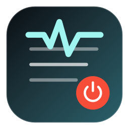
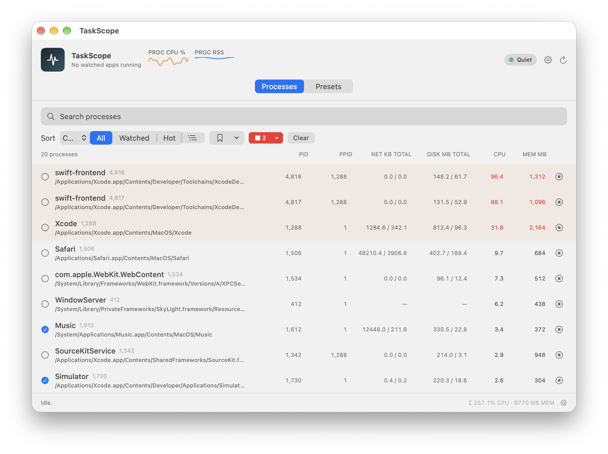
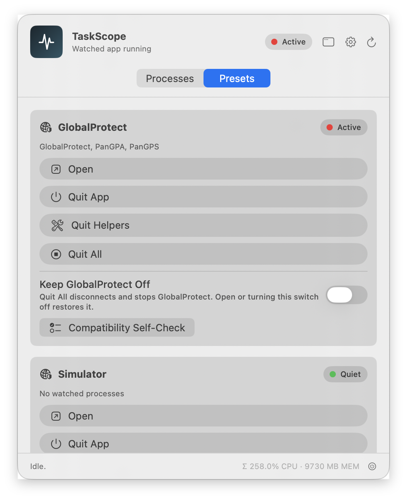

# TaskScope



TaskScope is a native macOS process monitor and task controller for the window
and menu bar.

[](LICENSE)
[](https://support.apple.com/macos)

<picture>
  <source media="(prefers-color-scheme: dark)" srcset="docs/images/main-window-dark.png">
  
</picture>

Screenshots show synthetic process data and were rendered on macOS 27.

## What it does

Inspect running processes, manage watched apps, and automate local process
rules. TaskScope combines a searchable process list with reviewed stop actions,
saved selections, and a built-in GlobalProtect preset.

This is a source release with local-development packaging. There is no
notarized app download. Read the [limitations](#project-status-and-limitations)
before installing.

## Features

- Search, filter, sort, and explore processes in flat or tree views.
- Review captured targets before Stop or Force Stop, with identity checks before signals.
- Create watched-app presets with Open, Quit App, Quit Helpers, and Quit All actions.
- Save process selections and preview matches before recalling them.
- Create Prompt, Auto Stop, or Log Only runtime rules and review their event history.
- View CPU and memory history and opt into watched-process notifications.
- Use Shortcuts, a configurable global hotkey, and optional Launch at Login.
- Inspect permissions and installation health, and preview redacted support reports.

## Requirements

- macOS 14 or later is the deployment target; runtime coverage varies by release.
- Swift tools 5.9 or later to build the package.
- Xcode 26 or later for the full test suite and App Intents metadata packaging.
- Local packaging has been verified on Apple silicon (arm64) only. Scripts build
  the current architecture and do not produce a universal binary.
- An existing, writable install destination; `/Applications` may require
  administrator access.

Packaging uses `TASKSCOPE_CODE_SIGN_IDENTITY` if supplied, otherwise the first
available Apple Development identity, with ad-hoc signing as a fallback.
Packaged App Intents need an eligible development signature to execute locally;
ad-hoc builds can validate metadata but cannot run those intents. Neither is a
Developer ID signature or notarization.

## Build and run from source

```bash
git clone https://github.com/38st/TaskScope.git
cd TaskScope
swift build -c debug
./script/build_and_run.sh
```

The last command builds a release executable, stages
`dist/build.noindex/TaskScope.app`, and opens it. The `.noindex` location avoids
a duplicate Spotlight build result; staging and verification remove temporary
launcher registrations.

```bash
./script/build_and_run.sh --stage       # stage without opening
./script/build_and_run.sh --verify      # verify the staged bundle and launch it for startup verification
./script/build_and_run.sh --debug       # run the debug executable in LLDB
./script/build_and_run.sh --logs        # open the app and stream local process logs
./script/build_and_run.sh --telemetry   # open the app and stream local subsystem logs
```

Every restage, including `--stage`, stops verified running copies of the staged
app before replacement. Before opening or debugging another bundle path, the
scripts check for a running copy with the same identifier and ask you to quit
that copy; the launch check does not stop it. This also applies to `--logs`,
`--telemetry`, and installer launches. If a duplicate same-user, same-identifier
app starts outside the scripts, it requests that the existing instance reopen
its window, including after a quiet login-item launch, and exits before commands
or background enforcement.

`--telemetry` only displays local macOS Unified Logs; it uploads nothing.
`BUILD_CONFIGURATION=debug` or `release` overrides the build configuration where
applicable. Finder and About use [VERSION](VERSION) and [BUILD_NUMBER](BUILD_NUMBER).

## Install locally and uninstall

```bash
./script/install.sh
```

Use `--no-open` to install without launching. To choose another existing writable
directory, use `DEST_DIR="$PWD/local-apps" ./script/install.sh --no-open` after
creating that directory. Installation validates the staged and copied bundle,
replaces the destination transactionally, and restores the prior app if replacement
fails. Export important presets before upgrading; this rollback does not migrate
preferences across incompatible releases.

Before removing TaskScope, clear any Keep Off overrides and remove its login
registration. **Open** or turning Keep Off off clears required GlobalProtect
overrides, even without saved intent or an installed app bundle. With the app
installed, it also restores the required service and app. Session-agent
installations retain the separate system-daemon override. Whenever Keep Off was
used, uninstall also requires clearing that override manually. If TaskScope is
already gone, clear all three overrides, regardless of layout. Follow the exact
commands and deletion steps in [Uninstall and erase local data](SUPPORT.md#uninstall-and-erase-local-data).

If data recovery is active, preserve the named `.corruptBackup` or
`.rejectedMigrationBackup` preference (including numbered slots) before reset or
deletion. See [stored-data recovery](SUPPORT.md#stored-data-is-unreadable).

## Using TaskScope

### Window and menu bar

Use the regular window or menu-bar popover for process review and presets. The
default global shortcut is **Control-Option-Command-T (⌃⌥⌘T)**; change it in
**Settings > Hotkey**. **Launch at Login** is in the **Presets** section of the
window and popover; login launches start quietly in the menu bar. The Requires
Approval and Unavailable states offer **Turn Off Launch at Login** to remove the
registration and report any error.

### Process list

Search, filter, and sort by CPU, memory, name, or PID. A truncated list shows
**Showing N of M**; Select All selects displayed matching rows. Review targets
before Stop (`SIGTERM`) or explicit Force Stop (`SIGKILL`). TaskScope never
signals itself, and rechecks process identity immediately before signaling.
Unavailable readings remain unavailable. See [process actions](docs/USING_TASKSCOPE.md#process-actions-and-observations).

### Presets and lifecycle actions

<picture>
  <source media="(prefers-color-scheme: dark)" srcset="docs/images/menu-bar-presets-dark.png">
  
</picture>

Add, edit, reorder, import, and export presets in **Settings > Watched Apps**.
Import previews every lifecycle field before saving and performs no action.
Custom presets can configure user launch agents, but cannot define privileged
system-daemon jobs. Main/helper detection, the Watched filter, and preset stops
require current-user ownership and the configured bundle boundaries. Preset
Quit, Close, and Keep Off wait up to three seconds before force stopping eligible
processes, as disclosed in confirmation. Read the [preset guide](docs/USING_TASKSCOPE.md#watched-app-presets)
before importing configuration.

The stale watched-status banner reports the last successful watched observation,
independently of the process-list update time, and includes the date for
observations before today. Stale single-process stops preserve displayed
Net/Disk readings.

### Auto-stop rules and saved selections

Start with Prompt or Log Only while checking a rule. All three rule actions
require current-user ownership and exclude TaskScope and unsignalable PIDs.
Auto Stop additionally requires a trusted executable path. Saved selections
use executable paths and show a recall preview; a path-backed entry never falls
back to name-only matching. See [rules](docs/USING_TASKSCOPE.md#runtime-rules)
and [saved selections](docs/USING_TASKSCOPE.md#saved-selections) for matching,
retry, migration, and retention details. An unanswered name-only prompt follows
a still-matching process when its executable moves; an explicit Dismiss remains
attached to that lifetime. Editing a rule cancels its unsignalled automatic stop
without recording a failure. Edits that keep Auto Stop enabled and matching
preserve an accepted request's retry budget.

### Shortcuts and URLs

A properly signed, installed app exposes **Refresh TaskScope**, **Open Watched
App**, and **Stop Watched App**. Stop requires system confirmation naming the app,
including direct Siri, Spotlight, and App Shortcut invocation. For GlobalProtect,
Shortcuts Stop has user-process scope and does not disconnect or stop VPN services.
Cold intent launches stay in the menu bar without an unintended window or Dock icon.

The packaged URL scheme accepts only `taskscope://refresh`, which refreshes
watched-app status. Every other route is rejected. See the [automation contract](docs/AUTOMATION.md)
for launch, cancellation, and administrator-approval boundaries.

## GlobalProtect support

The built-in preset's **Quit All** and explicit **Keep Off** attempt a verified
Disconnect before disabling known services. A timeout or unverifiable disconnect
leaves services running. The observation window is about 30 seconds (up to 60
observations with 0.5-second waits, plus reads), within a 90-second deadline that
also bounds Accessibility requests.

System-daemon changes require macOS administrator approval. On session-agent
installations, a loaded or uninspectable separate system daemon is preserved,
and the stop is reported as incomplete. **Open** and turning Keep Off off
restore the required service and app; they preserve the unused system override
on session layouts. Background enforcement never requests privileges and leaves
a loaded session VPN service running.

After a failed disconnect, **Stop Services Anyway…** requires separate confirmation
and can disrupt networking or leave stale VPN DNS. **Open** is the recovery path.
TaskScope does not rewrite network settings, store credentials, or bypass management
policy. Read [GlobalProtect behavior and recovery](docs/GLOBALPROTECT.md) and the
[compatibility evidence](GLOBALPROTECT_COMPATIBILITY.md) before use.

## Permissions

- **Accessibility:** exact Activity Monitor selection and explicit GlobalProtect
  disconnect. TaskScope verifies the target identity; ordinary monitoring needs
  no Accessibility access. It never enters VPN credentials or policy responses.
- **Notifications:** off on a new install; requested only after opt-in.
- **Launch at Login:** optional, managed in Presets and macOS Login Items.
- **Administrator approval:** only fixed built-in GlobalProtect daemon operations:
  disable/bootout through explicit Keep Off, Quit All, or Stop Services Anyway;
  enable/bootstrap through Open, toggle-off, or Open Watched App. No URL or
  background enforcement requests privileges; custom presets cannot add them.

See [Privacy permissions](PRIVACY.md#permissions) and the [threat model](THREAT_MODEL.md).

## Privacy

TaskScope runs locally, with no account, analytics, cloud sync, or diagnostic
upload. Preferences and exports can contain process names, paths, and rule data;
local notifications and logs can also reveal names. **Settings > Support** lets
you preview a redacted report before copying or saving it. Read [PRIVACY.md](PRIVACY.md)
for stored data, retention, permissions, and deletion.

## Development and the quality gate

Follow [CONTRIBUTING.md](CONTRIBUTING.md#development-workflow) for the complete
local build, test, strict-concurrency, and packaging gate. The packaging test
launches the staged app. Maintainers use [RELEASE.md](RELEASE.md) for release QA,
evidence, signing, and rollback requirements.

## Project status and limitations

- Source and local-development packaging; no notarized download is provided.
- Development bundle identifier: `com.local.TaskScope`. A future identifier
  changes preferences, permissions, Shortcuts, URL registration, and login-item
  identity; no automatic migration should be assumed.
- arm64 packaging is verified; Intel, universal binaries, and every macOS 14+
  runtime combination are not verified.
- GlobalProtect layouts, language, policy, and login/reboot behavior vary. Recorded
  observations from one configuration are not a general compatibility guarantee.
- Public binaries require the complete [release gate](RELEASE.md#additional-gate-for-a-public-binary),
  including candidate-specific lifecycle evidence, real signing credentials,
  notarization, and clean-machine checks. Do not redistribute a staged local app
  as a production download.

See the [roadmap](ROADMAP.md) and [changelog](CHANGELOG.md).

## Contributing, security, and license

Contributions are welcome; read [Contributing](CONTRIBUTING.md) and the
[Code of Conduct](CODE_OF_CONDUCT.md). For help, see [Support](SUPPORT.md).
Report vulnerabilities privately using the [Security policy](SECURITY.md).
TaskScope is available under the [MIT License](LICENSE).

TaskScope is independent. GlobalProtect and Palo Alto Networks are trademarks
of their respective owners; this project is not affiliated with or endorsed by
Palo Alto Networks.
